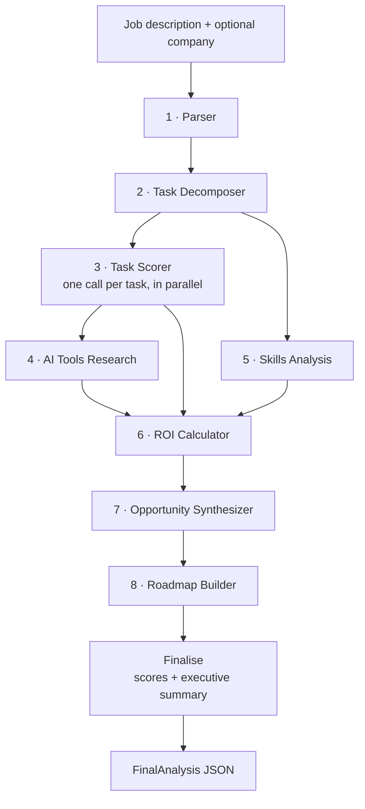

# AI Automation Index

An AI-powered tool that reads a job description and returns a scored, task-level assessment of how much of that role AI can augment today — with named tools, an hours-saved estimate, a skills outlook, and a phased implementation roadmap.

It has two halves:

1. **The analysis engine** — an 8-agent [LangGraph](https://langchain-ai.github.io/langgraphjs/) pipeline on Claude that turns one job description into a structured report. It is exposed as a streaming API (`POST /api/analyze`) and as a background job.
2. **The outreach platform around it** — an admin console that ingests a spreadsheet of target companies, scrapes their live career pages across 30+ applicant-tracking systems, analyses a sample of real roles per company, and publishes a private, token-gated report for each company. Engagement with those reports (opens, scroll depth, downloads, forwards) is tracked and shown in the admin.

Built by iMocha as the first tool in the **ARIA** initiative (see [`docs/ARIA_INITIATIVE_FRAMEWORK.md`](docs/ARIA_INITIATIVE_FRAMEWORK.md)). Production lives at `index.imocha.io`; the root path (`/`) currently redirects to `https://www.imocha.io/automation-index`.

---

## Contents

- [How it works](#how-it-works)
- [The analysis pipeline](#the-analysis-pipeline)
- [Scoring and ROI formulas](#scoring-and-roi-formulas)
- [Company ingestion and scraping](#company-ingestion-and-scraping)
- [Reports and analytics](#reports-and-analytics)
- [Admin console](#admin-console)
- [Tech stack](#tech-stack)
- [Project structure](#project-structure)
- [Getting started](#getting-started)
- [Environment variables](#environment-variables)
- [API reference](#api-reference)
- [Database](#database)
- [Scripts](#scripts)
- [Deployment](#deployment)
- [Hosting additional tools under `/<slug>`](#hosting-additional-tools-under-slug)
- [Documentation index](#documentation-index)
- [Known limitations](#known-limitations)

---

## How it works

```mermaid
flowchart LR
    A[Excel of companies<br/>+ career page URLs] --> B[Admin dataset]
    B --> C[Batch created<br/>company + report token]
    C -->|company/scrape| D[Scrape career page<br/>tiered cascade]
    D --> E[Validated JDs<br/>saved to Postgres]
    E -->|jd/analyze x N| F[8-agent LangGraph<br/>analysis]
    F --> G[Analyses in Postgres]
    G --> H[Company report hub<br/>+ per-role dashboards]
    H --> I[Telemetry<br/>opens, scroll, PDF, forwards]
    I --> J[Admin analytics]
```



Background work (scraping and analysis) runs on [Inngest](https://www.inngest.com/), so nothing blocks a request and every step is retried and observable.

---

## The analysis pipeline

The graph is defined in [`src/app/api/analyze/graph.ts`](src/app/api/analyze/graph.ts); each agent lives in [`src/app/api/analyze/agents/`](src/app/api/analyze/agents/).



| # | Agent | Model | What it produces |
|---|-------|-------|------------------|
| 1 | **Parser** | Claude Sonnet 4.6 | Job title, department, seniority, responsibilities, skills, tools, industry and team context |
| 2 | **Task Decomposer** | Claude Sonnet 4.6 | 6–10 concrete day-to-day tasks, each with a category and an `estimatedTimeShare` (renormalised to sum to 1.0) |
| 3 | **Task Scorer** | Claude Sonnet 4.6 | Per task: automation score (0–100), High/Medium/Low label, written rationale, and a specific AI tool. One call per task, run in parallel; a failed call falls back to a mid-range default instead of failing the run |
| 4 | **AI Tools Research** | Claude Sonnet 4.6 | 2–4 named, real tools per task scoring ≥ 40. Uses Tavily web search for context when `TAVILY_API_KEY` is set |
| 5 | **Skills Analysis** | Claude Sonnet 4.6 | Skills grouped as *future-proof*, *at risk*, or *AI-augmented*. Also uses Tavily when available |
| 6 | **ROI Calculator** | Deterministic math + Claude Haiku 4.5 | Hours saved per week and productivity multiplier (pure arithmetic); Haiku only writes the one-line "focus shift" |
| 7 | **Opportunity Synthesizer** | Claude Sonnet 4.6 | 4–6 prioritised opportunities, bundling tasks that one tool or workflow can cover |
| 8 | **Roadmap Builder** | Claude Sonnet 4.6 | Three phases (0–3, 3–9, 9–18 months) of tool-specific action items |
| — | **Finalise** | Claude Haiku 4.5 | Assembles the result, computes the aggregate scores, writes a 2–3 sentence executive summary (falls back to a template if the call fails) |

Agents 3 and 5 run concurrently. Agent 4 starts once scoring finishes because it needs the scores to decide which tasks to research.

All LLM calls use `temperature: 0`. The scoring model uses a human-in-the-loop calibration: a score reflects the share of a task's *execution time* AI tools could handle even with a person reviewing every output — not whether AI can replace the person.

Set `LANGCHAIN_TRACING_V2=true` and `LANGCHAIN_API_KEY` to trace every agent call (inputs, outputs, latency, tokens) in LangSmith.

Full prompts, inputs and output types for every agent are in [`docs/analysis-pipeline.md`](docs/analysis-pipeline.md).

---

## Scoring and ROI formulas

These are the values in the code today (`graph.ts`, `agents/scorer.ts`, `agents/roiCalculator.ts`).

**Per-task automation score → label**

| Score | Label |
|-------|-------|
| ≥ 65 | High |
| 40 – 64 | Medium |
| < 40 | Low |

The label is recomputed from the score in code, so the two can never disagree.

**Role-level scores** (time-weighted, because shares sum to 1.0)

```
overallAutomationScore = round( Σ score × timeShare )

aiReadinessScore       = round( Σ score × timeShare / Σ timeShare  over tasks with score ≥ 40  ×  0.85 )
                         (40 if no task scores ≥ 40)

automationByCategory   = the same weighted average, grouped by task category
```

**Hours saved and productivity multiplier** (no LLM involved)

```
taskHours      = 40 × timeShare
hoursSaved     = taskHours × (score / 100) × 0.65          # 0.65 efficiency factor: setup, errors, review
totalHours     = min( round( Σ hoursSaved ), 20 )           # capped at 20 h/week
multiplier     = round( (40 + totalHours) / 40 , to nearest 0.5 )   # shown as e.g. "1.5x"
```

The line-by-line working is stored with every report (`roiHighlights.formula`) so the figure can be audited.

> **Heads up:** [`docs/AI_AUTOMATION_INDEX_EXECUTIVE_BRIEF.md`](docs/AI_AUTOMATION_INDEX_EXECUTIVE_BRIEF.md) and [`docs/AI_AUTOMATION_INDEX_METHODOLOGY.md`](docs/AI_AUTOMATION_INDEX_METHODOLOGY.md) were written for leadership earlier and quote slightly different constants (a 12 h cap, a ≥ 70 "High" threshold, different readiness wording). The code above is the source of truth.

---

## Company ingestion and scraping

### 1. Ingest

An admin uploads an Excel file on **Admin → Dataset**. Required columns are `Company Name` and `Career Page URL`. Optional columns: `Domain` (derived from the URL if blank), `Headquarters`, `Employee Size`, `HCM / HRIS / ATS`, `#`, and point-of-contact first name / last name / email (matched flexibly, e.g. `First Name`, `POC First Name`). Re-uploading dedupes by domain and refreshes contact fields on rows that already exist. The ATS label is normalised to a canonical value (`workday`, `sap_sf`, `oracle_hcm`, `greenhouse`, …) — see [`src/lib/ats.ts`](src/lib/ats.ts).

Selecting rows and creating batches produces one batch per company, with a URL-safe slug and an unguessable report token, then queues a `company/scrape` event.

### 2. Scrape (Inngest `scrape-company`, concurrency 5)

[`src/lib/scraper.ts`](src/lib/scraper.ts) picks the cheapest reliable method for each site and falls through if it finds nothing:

| Tier | Method | Used for |
|------|--------|----------|
| 0 | Custom scrapers (`src/lib/scrapers/`, 36 files) | Employers whose sites defeat the generic paths (State Farm, MetLife, Aflac, Amica, Assurant, UnitedHealth/Optum, AXA US, Capgemini, and others), plus platforms chosen by the dataset's ATS value or the URL: BambooHR, Darwinbox, Keka, TurboHire, RippleHire, Zwayam, Phenom, Eightfold, Jibe |
| 1a | Public ATS JSON APIs | Greenhouse, Lever, SmartRecruiters — structured data, no HTML parsing |
| 1b | Enterprise HCM scrapers | Workday (CxS API), Oracle HCM and Taleo, SAP SuccessFactors, iCIMS — chosen by the dataset's ATS value or URL pattern, which takes priority over auto-detection |
| 2 | Static HTML with `cheerio` | Plain career sites. Skipped for hosts known to be JS-rendered SPAs |
| 3 | [Firecrawl](https://www.firecrawl.dev/) | JS-rendered pages (also recovers Teamtailor sites on custom domains). Only active when `FIRECRAWL_API_KEY` is set |

**Quality gates.** Scraped text is validated before it is stored ([`src/lib/validation.ts`](src/lib/validation.ts)): marketing and navigation pages are rejected by title pattern, and content must contain enough real job-description signals. Invalid rows are kept with status `invalid` so admins can inspect them. A post-scrape check also detects "listing page noise" (navigation anchors, identical bodies on every row) and, for Workday sites, automatically retries through the Workday API ([`docs/scraper-adaptive-fallback.md`](docs/scraper-adaptive-fallback.md)).

**How many roles.** [`src/lib/jdLimits.ts`](src/lib/jdLimits.ts) scrapes 15 roles per company (20 when the company has more than 50 open roles) and analyses 10 (15 for large companies). The remainder stay in reserve and are promoted automatically if an earlier role turns out to be invalid.

### 3. Analyse (Inngest `analyze-jd`, concurrency 3, 2 retries)

Each queued role runs through the full pipeline and its result is written to the `analyses` table as JSONB, alongside `overall_score` and `hours_saved` for fast list views. When the last role in a batch finishes, the batch is marked `complete` (or `partial_failure`) and the company-level "wizard data" used by the report hub is computed from that batch's analyses.

### 4. Daily catch-up (Inngest `daily-batch-cron`, 06:00 UTC)

Queues up to 100 companies still waiting to be scraped (which also throttles very large uploads). If there are none, it re-queues up to 50 roles stuck in `pending`.

Pipeline details and failure handling: [`docs/scraping-and-ingestion.md`](docs/scraping-and-ingestion.md), [`docs/scraping-plan-workday-oracle-sap.md`](docs/scraping-plan-workday-oracle-sap.md).

---

## Reports and analytics

### Report pages

| Route | What it shows |
|-------|---------------|
| `/report/<slug-or-id>?token=…` | **Hub** — a four-step wizard (at a glance → benefit → peer comparison → roles) built from the company's aggregated analyses |
| `/report/<slug-or-id>/<analysisId>?token=…` | **Role dashboard** — scores, category radar, tasks, skills, opportunities, roadmap |
| `GET /api/report/<id>/<analysisId>/pdf?token=…` | PDF of a role report, rendered with headless Chromium (Playwright) |

Access is gated by a per-company random token stored on the company record. A wrong or missing token returns a 404 on the pages and a 403 on the per-analysis API, PDF, ZIP download and lead endpoints. (The company-level listing `GET /api/report/<companyId>` does not check a token — see [Known limitations](#known-limitations).)

### Engagement tracking

Report pages record behaviour through [`src/lib/reportTrack.ts`](src/lib/reportTrack.ts), which writes to two places:

- **Postgres** (`report_events`) via `POST /api/track` — session ID, event, job title, a salted SHA-256 hash of the visitor's IP, user agent, referrer, and city/region/country from a local MaxMind GeoLite2 lookup. This powers the admin analytics. Invalid input is silently ignored so the endpoint reveals nothing.
- **PostHog** (legacy, still sent) — the report token is the distinct ID.

Events: `report_opened`, `report_section_viewed`, `report_scrolled_depth` (25/50/75/100), `report_downloaded`, `report_tab_hidden` / `report_tab_visible`, `report_session_end`. A report counts as **forwarded** when one token is opened from more than one device. Email addresses captured by the wizard's HubSpot form are stored in `report_leads`.

Scroll, section and download events fire only on the role dashboard, so hub-only companies legitimately show zeros for those. See [`docs/admin-data-flow.md`](docs/admin-data-flow.md), [`docs/report-analytics.md`](docs/report-analytics.md) and [`docs/analytics-migration.md`](docs/analytics-migration.md).

Microsoft Clarity is also loaded in production builds.

---

## Admin console

Everything under `/admin` (UI) and `/api/admin` (API).

| Page | Purpose |
|------|---------|
| `/admin/dataset` | Upload and manage the company spreadsheet, validate career-page URLs, filter by ATS or industry, create batches, export |
| `/admin/batches` | Watch scrape/analysis progress live, drill into a company's roles, re-run, retry, stop, or skip individual roles, export contacts with report links |
| `/admin/downloads` | Leads and PDF downloads: wizard CTA submissions, role-card downloads, in-report downloads |
| `/admin/analytics` | Per-company engagement table (opens, sessions, devices, downloads, last activity, top location) with 7d/30d/90d/all filters, and a per-company drill-down with scroll funnel, sections viewed and a raw event timeline |

There is also a Workday-outreach export (`/api/admin/export/workday-outreach`) that lists Workday companies with completed analyses and their report links.

---

## Tech stack

| Area | Technology |
|------|------------|
| Framework | Next.js 16 (App Router), React 19, TypeScript 5 |
| Styling and charts | Tailwind CSS 4, Recharts |
| AI | Claude Sonnet 4.6 and Haiku 4.5 via `@langchain/anthropic`; orchestration with `@langchain/langgraph`; tracing with LangSmith |
| Database | PostgreSQL on [Neon](https://neon.tech/) (`@neondatabase/serverless`), Drizzle ORM |
| Background jobs | Inngest 4 |
| Scraping | `cheerio`, Firecrawl, plain `fetch` against ATS APIs |
| Spreadsheets | `xlsx` |
| PDF | `playwright-core` with Chromium |
| Geo | MaxMind GeoLite2-City (`@maxmind/geoip2-node`) |
| Analytics | PostHog, Microsoft Clarity, first-party `report_events` |
| Lead capture | HubSpot forms |
| Web search (optional) | Tavily (analysis agents); DuckDuckGo with Google Custom Search fallback (`src/lib/webSearch.ts`) |

---

## Project structure

```
.
├── src/
│   ├── app/
│   │   ├── page.tsx                 # redirects to imocha.io/automation-index
│   │   ├── dashboard/               # renders an analysis stored in sessionStorage
│   │   ├── preview/                 # static prospect-demo page
│   │   ├── report/[companyId]/      # token-gated report hub + per-role dashboard
│   │   ├── admin/                   # admin console pages
│   │   └── api/
│   │       ├── analyze/             # SSE endpoint, LangGraph graph, 8 agents
│   │       ├── admin/               # dataset, batches, JDs, exports, login
│   │       ├── report/              # report data, PDF, download, lead capture
│   │       ├── track/               # engagement events
│   │       ├── inngest/             # Inngest serve endpoint
│   │       └── logo/                # company logo proxy
│   ├── components/                  # DashboardView, charts, admin UI, report wizard
│   ├── inngest/                     # scrapeCompany, analyzeJD, dailyCron
│   └── lib/
│       ├── db/                      # Drizzle client and schema
│       ├── scrapers/                # 36 platform/company scrapers
│       ├── scraper.ts               # tier cascade and quality guards
│       ├── report/aggregate.ts      # company-level wizard data
│       ├── geoip.ts, reportTrack.ts, token.ts, slug.ts, validation.ts, …
├── drizzle/                         # SQL migrations and snapshots
├── scripts/                         # one-off ops scripts (see below)
├── data/                            # GeoLite2 database and reference spreadsheets
├── docs/                            # architecture, methodology, plans, audits
├── next.config.ts                   # tool-route rewrites (see below)
├── Dockerfile, nixpacks.toml, vercel.json
└── start.sh, stop.sh                # local dev launcher
```

---

## Getting started

### Prerequisites

- Node.js 20+ and npm
- A [Neon](https://neon.tech/) (or any Postgres) database
- An Anthropic API key
- *Optional:* Firecrawl, Tavily, LangSmith and PostHog keys (see below)
- *Optional:* Chrome or Chromium installed locally if you want to generate PDFs in development

### Install and configure

```bash
git clone https://github.com/Aryanpawar67/ai-automation-index.git
cd ai-automation-index
npm install
```

Create `.env.local` in the project root (the `.env*` pattern is git-ignored). A minimal local setup:

```bash
DATABASE_URL=postgres://…            # Neon connection string
ANTHROPIC_API_KEY=sk-ant-…
ADMIN_PASSWORD=choose-a-password

# Inngest dev server
INNGEST_DEV=1
INNGEST_BASE_URL=http://localhost:8288
```

Push the schema to your database:

```bash
npx drizzle-kit push
```

### Run it

The easy way starts the Next.js dev server on port **3003** and the Inngest dev server together:

```bash
./start.sh        # logs go to .logs/
./stop.sh         # stops both and frees the ports
```

Or run them yourself in two terminals:

```bash
PORT=3003 npm run dev
npx inngest-cli@latest dev -u http://localhost:3003/api/inngest
```

| URL | What |
|-----|------|
| http://localhost:3003/admin | Admin console (log in with `ADMIN_PASSWORD`) |
| http://localhost:3003/api/analyze | Analysis API (see below) |
| http://localhost:8288 | Inngest dev UI: events, runs, retries |

### Try the analysis engine

With `ANTHROPIC_API_KEY` set, you can run the pipeline directly:

```bash
curl -N -X POST http://localhost:3003/api/analyze \
  -H "Content-Type: application/json" \
  -d '{"jobDescription": "<paste a job description of at least 50 characters>", "company": "Acme"}'
```

You'll receive a stream of server-sent events: one `agent_complete` per step, then a `complete` event carrying the full result.

### Other commands

```bash
npm run build      # production build
npm start          # serve the production build
npm run lint       # ESLint
```

---

## Environment variables

Only variables that the code actually reads are listed.

| Variable | Required | Purpose |
|----------|:--------:|---------|
| `DATABASE_URL` | Yes | Postgres connection string (Drizzle, scripts and migrations) |
| `ANTHROPIC_API_KEY` | Yes | All Claude calls. `/api/analyze` returns an error without it |
| `ADMIN_PASSWORD` | Yes | Password accepted by `/api/admin/login` |
| `INNGEST_EVENT_KEY` | Prod | Authenticates events sent to Inngest |
| `INNGEST_SIGNING_KEY` | Prod | Verifies Inngest → app invocations |
| `INNGEST_DEV` | Dev | Set to `1` to run against the local Inngest dev server |
| `INNGEST_BASE_URL` | Dev | `http://localhost:8288` for local development |
| `FIRECRAWL_API_KEY` | Optional | Enables Firecrawl scraping for JS-rendered career sites (several scrapers need it) |
| `TAVILY_API_KEY` | Optional | Live web research for the tools and skills agents; skipped if unset |
| `LANGCHAIN_TRACING_V2`, `LANGCHAIN_API_KEY` | Optional | LangSmith tracing (the docs use the project name `ai-automation-index`) |
| `NEXT_PUBLIC_POSTHOG_PROJECT_TOKEN`, `NEXT_PUBLIC_POSTHOG_HOST` | Optional | PostHog client analytics |
| `REPORT_EVENTS_IP_SALT` | Recommended | Salt for hashing visitor IPs in `report_events` |
| `NEXT_PUBLIC_APP_URL` / `NEXT_PUBLIC_BASE_URL` | Optional | Base URL the PDF renderer opens; falls back to the request host |
| `GOOGLE_CSE_KEY`, `GOOGLE_CSE_CX` | Optional | Google Custom Search fallback for `webSearch` |
| `CLEARBIT_API_KEY` | Optional | Company logo lookup (`/api/logo`) |
| `HMAC_SECRET` | Optional | Used only by the signed-token helpers in `src/lib/token.ts`. Report links currently use random tokens stored in the database, so this isn't on the live path |
| `APP_BASE_URL` | Scripts | Used by some one-off scripts |

---

## API reference

### Public

| Method and path | Description |
|-----------------|-------------|
| `POST /api/analyze` | Body: `{ jobDescription: string (≥ 50 chars), company?: string }`. Streams SSE events: `agent_complete` (`agent`, `step`, `totalSteps` = 7, partial `data`), then `complete` (with `result`: the full analysis), or `error` (`message`) |
| `GET /api/report/<companyId>` | Company name, and the title, score and hours saved of each valid analysis (slug or UUID accepted). No token required |
| `GET /api/report/<companyId>/<analysisId>?token=` | One full analysis |
| `GET /api/report/<companyId>/<analysisId>/pdf?token=` | Role report as PDF |
| `GET /api/report/<companyId>/download?token=` | Bundled download of the company's reports |
| `POST /api/report/<companyId>/interest?token=` | Records a lead from the report CTA |
| `POST /api/track` | Records an engagement event (always returns 204) |
| `POST /api/preview/track-download`, `POST /api/preview/validate-email` | Preview-flow helpers |
| `GET\|POST\|PUT /api/inngest` | Inngest handler (not for direct use) |

### Admin (`/api/admin/…`)

| Area | Endpoints |
|------|-----------|
| Auth | `POST /login` |
| Dataset | `GET /dataset` (filters: `ats`, `industry`, and more), `POST /dataset/upload` (supports `?dryRun=true`), `POST /dataset/manual`, `POST /dataset/batch`, `POST /dataset/validate-all`, `GET /dataset/export`, `POST /dataset/flush`, `PATCH /dataset/rows/:id` |
| Batches | `GET /batches`, `DELETE /batches/:id`, `POST /batches/:id/analyse`, `POST /batches/:id/stop`, `GET /batches/:id/export`, `GET /batches/:id/companies/:companyId/jds`, `GET /batch-progress/:id` |
| Companies | `PATCH /companies/:id`, `POST /company/:id/retry-scrape`, `POST /company/:id/stop`, `POST /retry` |
| Individual roles | `POST /jd/:id/analyse`, `POST /jd/:id/skip` |
| Other | `GET`/`DELETE /downloads`, `POST /validate-url`, `POST /merge-contacts`, `GET /export/companies`, `GET /export/workday-outreach`, `GET /debug` |

---

## Database

Schema: [`src/lib/db/schema.ts`](src/lib/db/schema.ts). Sync it with `npx drizzle-kit push`; the SQL files in [`drizzle/`](drizzle/) record how it evolved (some were applied with the `scripts/run-*-migration.mjs` helpers).

```
batches ─┬─ pocs
         └─ job_descriptions ── analyses        (JSONB result + overall_score + hours_saved)
companies ─┬─ pocs / job_descriptions / analyses
           ├─ report_leads       (email captures)
           └─ report_events      (engagement telemetry, indexed by company, token, session)
dataset_rows                      (uploaded spreadsheet + URL-validation results)
report_downloads                  (PDF download records)
```

| Table | Holds |
|-------|-------|
| `dataset_rows` | The master company list: domain, ATS, career URL, POC contact, and URL-validation results. Also has columns for HR-stack, LinkedIn and industry enrichment |
| `batches` | One per scrape/analysis run, with progress counters |
| `companies` | Name, career URL, ATS type, slug, report token, scrape status, total open roles, and the precomputed `wizard_data` for the report hub |
| `job_descriptions` | Scraped roles. Status: `scraped` → `pending` → `analyzing` → `complete`, or `failed` / `invalid` / `cancelled` |
| `analyses` | One finished pipeline result per role |
| `report_events`, `report_leads`, `report_downloads` | Engagement, leads and downloads |

---

## Scripts

[`scripts/`](scripts/) holds one-off operational tools, mostly for onboarding or repairing specific employers. They talk to the database directly, so they need `DATABASE_URL` (and `INNGEST_*` for those that queue work). Run them like:

```bash
npx tsx --env-file=.env.local scripts/<name>.ts
```

Naming convention:

| Prefix | Use |
|--------|-----|
| `setup-*`, `add-*` | Create a company/batch with the right career URL and ATS |
| `probe-*`, `test-*`, `check-*`, `debug-*` | Investigate how a site behaves or inspect database state |
| `rescrape-*`, `trigger-*`, `fix-*`, `reset-*` | Re-run or repair a company's scrape or analysis |
| `process-*` | Scrape and analyse a named employer end to end |
| `run-*-migration.mjs` | Apply a specific SQL migration |
| `export-*`, `sync-excel-from-db.mjs`, `build_aria_excel.py` | Spreadsheet exports and tooling |

Most of these are tied to specific historical situations — read a script before running it.

---

## Deployment

The app is a standard Next.js server and ships three ways:

- **Docker** — [`Dockerfile`](Dockerfile): Node 20, installs Playwright's Chromium and its system libraries (needed for PDF generation), runs `npm run build`, serves on port 3000.
- **Nixpacks (Railway)** — [`nixpacks.toml`](nixpacks.toml) lists the apt packages Chromium needs.
- **Vercel** — [`vercel.json`](vercel.json) declares the Next.js framework build. Note that PDF generation relies on a Chromium binary, which the Docker/Railway paths provide.

In production, set the Inngest keys and register `https://<your-host>/api/inngest` with Inngest so the scrape, analyse and cron functions are picked up. The GeoIP lookup reads `data/GeoLite2-City.mmdb`; without that file tracking still works but location fields are empty.

---

## Hosting additional tools under `/<slug>`

[`next.config.ts`](next.config.ts) acts as a reverse proxy so other services can be served from `index.imocha.io/<slug>`. Add an entry to `TOOL_ROUTES` and redeploy — no DNS changes needed. Today it routes `/skill-lens/*` to the SkillLens service. The rewrites must stay in `beforeFiles`, otherwise Next.js intercepts `/api/*` paths itself and the upstream returns 404/405.

The full checklist — routing, CORS, challenge tokens, bot protection, security headers and a deployment order — is in [`ADDING_TOOLS.md`](ADDING_TOOLS.md).

---

## Documentation index

| Document | Covers |
|----------|--------|
| [`docs/analysis-pipeline.md`](docs/analysis-pipeline.md) | Every agent, prompt, input and output type |
| [`docs/scraping-and-ingestion.md`](docs/scraping-and-ingestion.md) | Upload → scrape → analyse → report |
| [`docs/scraper-adaptive-fallback.md`](docs/scraper-adaptive-fallback.md) | Garbage-output detection and Workday recovery |
| [`docs/scraping-plan-workday-oracle-sap.md`](docs/scraping-plan-workday-oracle-sap.md) | Enterprise HCM scraping plan |
| [`docs/admin-data-flow.md`](docs/admin-data-flow.md) | How user actions become admin analytics |
| [`docs/report-analytics.md`](docs/report-analytics.md) | PostHog events and how to read them |
| [`docs/analytics-migration.md`](docs/analytics-migration.md) | PostHog → first-party analytics |
| [`docs/INDUSTRY_ENRICHMENT.md`](docs/INDUSTRY_ENRICHMENT.md) | Industry-sector enrichment plan |
| [`docs/AI_AUTOMATION_INDEX_EXECUTIVE_BRIEF.md`](docs/AI_AUTOMATION_INDEX_EXECUTIVE_BRIEF.md), [`…_METHODOLOGY.md`](docs/AI_AUTOMATION_INDEX_METHODOLOGY.md) | Leadership-facing explanations (some constants differ from the code) |
| [`docs/ARIA_INITIATIVE_FRAMEWORK.md`](docs/ARIA_INITIATIVE_FRAMEWORK.md) | The wider ARIA tool programme |
| [`docs/AGENTIC_ARCHITECTURE_PLAN.md`](docs/AGENTIC_ARCHITECTURE_PLAN.md), [`docs/agent-pipeline-audit.md`](docs/agent-pipeline-audit.md), [`docs/AUDIT_REPORT.md`](docs/AUDIT_REPORT.md) | Architecture rationale and audits |
| [`docs/ANALYSIS-AND-NEXT-STEPS.md`](docs/ANALYSIS-AND-NEXT-STEPS.md), [`docs/UI_REVAMP.md`](docs/UI_REVAMP.md), [`docs/multi-touch-landing-pages.md`](docs/multi-touch-landing-pages.md) | Report redesign, admin UI revamp, outreach landing pages |
| [`docs/plans/`](docs/plans/) | Auto-recovery scraper agent, PostHog migration |
| [`ADDING_TOOLS.md`](ADDING_TOOLS.md) | Shipping a new tool under `index.imocha.io/<slug>` |

 components exist but aren't linked from the wizard** (kept for a future download button).
